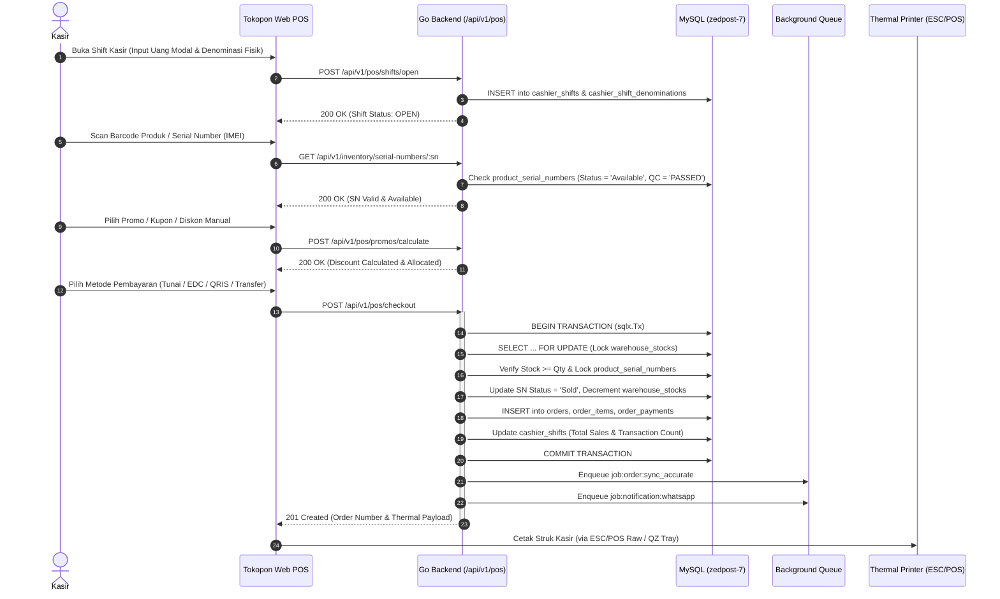

# ⚙️ Tokopon Ecosystem — Business Logic & Operational Workflows

> **Katalog Rekonstruksi Aturan Bisnis & Workflow Operasional Tokopon**  
> Sumber Legacy: `tokopon-zed-offline` (Laravel) | Target Paritas: `tokopon-go` (Go)  
> Status Audit: **VERIFIED**

---

## 📌 1. Retail POS Kasir Toko Fisik ([MOD-02])

### Tujuan Bisnis:
Memproses penjualan ritel di toko cabang (baik unit baru Syihab Store maupun unit bekas GSK Store) secara cepat, aman, bebas overselling, serta mencetak struk fisik dan mengirim struk digital WhatsApp ke pelanggan.

### Invarian & Aturan Bisnis POS:
1. **Pemeriksaan Shift Aktif:** Transaksi kasir hanya dapat dilakukan jika kasir memiliki shift berstatus `open` di cabang dan unit bisnis yang sama.
2. **Kunci Baris Pesimistik (Anti-Overselling):** Kueri pengurangan stok di `warehouse_stocks` dan reservasi IMEI di `product_serial_numbers` **WAJIB** menggunakan `SELECT ... FOR UPDATE` dalam transaksi SQL.
3. **Validasi Perangkat Bekas:** Jika produk adalah HP bekas (`is_second = 1`), nomor seri hanya boleh dijual jika status QC bernilai `PASSED`.
4. **Denominasi Uang Fisik:** Pembukaan dan penutupan shift mencatat rincian lembaran fisik uang (Rp 100.000 s/d Rp 100) untuk mendeteksi selisih kas (`balanced`, `over`, atau `short`).
5. **Non-Blocking Queue Dispatch:** Sinkronisasi Accurate Online dan pengiriman WhatsApp wajib dimasukkan ke antrean latar belakang (*background queue*) agar kasir tidak terblokir oleh latency jaringan eksternal.

---

## 🎯 2. In-Memory Promo & Discount Engine ([MOD-04])

### Alur Evaluasi Diskon:
Promo Engine mereplikasi 100% presisi perilaku `PromoCalculatorService` dari Laravel:
1. **Filter Kelayakan (Eligibility):**
   - Tanggal promo berada dalam rentang `start_date` s/d `end_date`.
   - Kuota promo belum habis (`quota > 0` atau `quota IS NULL`).
   - Sesuai dengan `business_unit_id` dan `branch_id` transaksi.
2. **Perhitungan Potongan:**
   - **Tipe Diskon:** Persentase (`percentage`) atau Nominal Tetap (`fixed`).
   - **Maksimal Diskon (Cap):** Jika ada `max_discount`, potongan dibatasi pada nilai maksimum tersebut.
   - **Multiplier (`is_multiply = 1`):** Diskon dikalikan dengan jumlah qty item yang memenuhi syarat.
   - **Batas Kuantitas (`max_qty`):** Multiplier dibatasi maksimal hingga `max_qty`.
3. **Bundling SKU:**
   - Promo dapat menetapkan daftar SKU utama dan SKU bundling dengan batas `bundle_max_qty`.
4. **Kombinabilitas (Combinability Rules):**
   - Promo dengan `is_combinable = 0` tidak boleh digabungkan dengan promo lain dalam satu keranjang belanja.
5. **Alokasi Diskon Proporsional:**
   - Nilai diskon dialokasikan secara proporsional ke masing-masing baris item belanja (`order_items.discount_amount`) agar kalkulasi HPP dan margin laba rugi per-item tetap akurat.

---

## 📦 3. Manajemen Stok, Gudang & Stock Opname ([MOD-03])

### 1. Inbound PO Receiving:
- Staff gudang menerima barang dari Vendor berdasarkan Purchase Order (`purchase_orders`).
- Untuk produk bernomor seri (Smartphone/Tablet), staf memindai IMEI satu per satu. Sistem memvalidasi agar tidak terjadi duplikasi IMEI (`product_serial_numbers`).
- Kuantitas stok gudang (`warehouse_stocks`) bertambah secara atomik bersamaan dengan pembuatan record nomor seri baru berstatus `Available`.

### 2. Sesi Stock Opname Fisik:
- Hanya boleh ada **1 sesi opname aktif per gudang**.
- **Snapshot Otomatis:** Saat sesi opname dibuka, sistem membekukan snapshot kuantitas sistem saat itu.
- **Scanning Fisik:** Petugas memindai IMEI fisik di toko. Sistem mencatat FSM status:
  - `MATCHED`: Unit tercatat di sistem dan ditemukan fisik di toko.
  - `MISSING`: Unit tercatat di sistem namun tidak ditemukan fisik (potensi hilang/selisih).
  - `UNEXPECTED`: Fisik ditemukan di toko tetapi tidak tercatat di gudang tersebut (nyasar/salah lokasi).
- **Finalisasi & Penyesuaian:** Saat difinalisasi, sistem menghitung total kerugian/kelebihan finansial dan secara otomatis membuat `stock_adjustments` dengan kode `ADJ-YYYYMMDD-XXXX`.

---

## 📱 4. Trade-In, Buyback & Digital Device Passport ([MOD-06])

### Alur Operasional Tukar Tambah & HP Bekas:
1. **Intake HP Bekas (Buyback):**
   - Pelanggan membawa HP lama ke cabang GSK Second (`business_unit_id = 2`).
   - Kasir/Teknisi menginput IMEI dan menjalankan checklist inspeksi QC (`qc_templates`).
2. **Evaluasi Fatal Failure:**
   - Jika terdapat checklist dengan tanda `is_fatal = 1` yang gagal (misalnya: *iCloud terkunci*, *mati total*, atau *IMEI terblokir Kemenperin*), vonis QC langsung menjadi **`FAIL`** dan transaksi ditolak otomatis.
   - Jika lulus dengan cacat minor (layar gores ringan), vonis menjadi `CONDITIONAL` dengan penalti pengurangan taksiran harga.
3. **Penyelesaian Buyback:**
   - Jika pelanggan setuju dengan nilai taksiran, sistem menerbitkan nota buyback, mendaftarkan IMEI ke `product_serial_numbers` dengan status `In Repair` / `Available`, dan menambah stok gudang second.
   - Jika berupa **Trade-In**, nilai buyback langsung memotong nilai keranjang belanja unit baru pelanggan.
4. **Digital Device Passport:**
   - Setiap IMEI memiliki paspor digital seumur hidup yang mengagregasikan seluruh riwayat:
     - Tanggal pembelian awal & supplier.
     - Riwayat pergantian sparepart & hasil checklist QC.
     - Riwayat klaim garansi toko.
     - Riwayat jual-beli trade-in & kepemilikan sebelumnya.

---

## 🎁 5. Customer Loyalty & Coupons ([MOD-05])

1. **Perolehan Poin (Earning):**
   - Pelanggan memperoleh **1 Poin untuk setiap kelipatan Rp 10.000** nilai belanja bersih.
2. **Penukaran Poin (Redemption):**
   - **Nilai Tukar:** **1 Poin = Rp 100**.
   - **Batas Minimum Redeem:** Minimal 50 poin (setara potongan Rp 5.000).
   - Saat redeem, saldo dipotong dan dicatat di buku besar mutasi `loyalty_transactions`.
3. **Kupon E-Commerce & Retail:**
   - Validasi batas waktu kupon, kuota global, batasan pemakaian per pelanggan, dan nilai minimum belanja.
   - Kupon otomatis di-rollback jika transaksi pesanan dibatalkan atau kedaluwarsa.

---

## 📊 6. Formula Finansial & Executive Reporting ([MOD-08])

### Formula Standar Akuntansi Tokopon:
- **Omzet Penjualan Kotor (Gross Sales):** $\sum \text{orders.total\_amount}$
- **Omzet Penjualan Bersih (Net Sales):** $\text{Gross Sales} - \sum \text{orders.discount\_amount}$
- **Harga Pokok Penjualan (HPP / COGS):** Nilai modal unit saat dibeli dari vendor (`product_serial_numbers.buy_price` atau snapshot HPP produk).
- **Laba Kotor (Gross Profit):** $\text{Net Sales} - \text{Total HPP}$
- **Margin Laba Kotor (Gross Margin %):** $\frac{\text{Gross Profit}}{\text{Net Sales}} \times 100\%$
- **Average Order Value (AOV / Basket Size):** $\frac{\text{Net Sales}}{\text{Total Completed Orders}}$
- **Komisi Salesman:** Standar 1% dari nilai penjualan bersih yang ditangani salesman tersebut.
- **Rekonsiliasi Kas Shift:**
  $$\text{Selisih Kas} = \text{Uang Fisik Aktual} - (\text{Modal Awal} + \text{Total Penjualan Tunai})$$
  - Jika Selisih = 0 $\rightarrow$ `balanced`
  - Jika Selisih > 0 $\rightarrow$ `over` (kas lebih)
  - Jika Selisih < 0 $\rightarrow$ `short` (kas kurang)

---

## 🔄 7. Integrasi Asinkron Accurate Online ERP ([MOD-07])

1. **Urutan Sinkronisasi:**
   - Langkah 1: Cek/Buat Pelanggan di Accurate (`/customer/save.do`).
   - Langkah 2: Buat Faktur Penjualan di Accurate (`/sales-invoice/save.do`) dengan detail item, HPP, diskon, dan nomor seri.
   - Langkah 3: Jika transaksi lunas, buat Penerimaan Penjualan (`/sales-receipt/save.do`) ke akun kas/bank yang sesuai.
2. **Idempotency Guard:**
   - Sebelum mengirim faktur ke Accurate, sistem memeriksa tabel `order_accurate_docs`. Jika pesanan sudah memiliki nomor faktur Accurate, proses sinkronisasi dilewati untuk mencegah faktur ganda.
3. **Exponential Backoff Retry:**
   - Jika Accurate mengembalikan timeout atau error 5xx, worker mencoba kembali dengan jeda bertingkat: 500ms $\rightarrow$ 2 detik $\rightarrow$ 5 detik $\rightarrow$ 10 detik.
