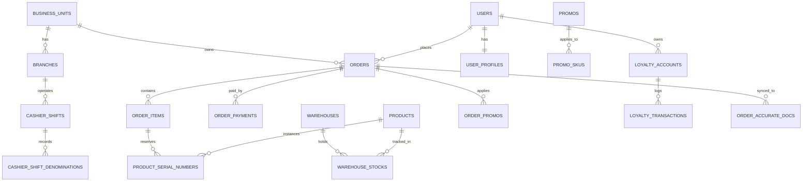

# 🗄️ Tokopon Ecosystem — Database Map & Schema Topology

> **Peta Skema Basis Data Terpadu: MySQL (`zedpost-7`)**  
> Sumber Otoritas Skema: `tokopon-zed-offline` (238 Migrasi Laravel) & `tokopon-go` (8 Migrasi Mandiri)  
> Status Audit: **VERIFIED**

---

## 📌 1. Prinsip Utama Skema

1. **Shared Database, Shared Schema:** Satu database melayani seluruh lini bisnis Tokopon (Syihab Store, GSK Second, GSK Distri).
2. **Column-Based Multi-Tenancy:** Tabel-tabel transaksi dan operasional memuat kolom `business_unit_id`.
3. **No Automatic Global Scopes:** Database tidak mengisolasi tenant secara otomatis pada level driver. Seluruh filter tenant **WAJIB** dikendalikan eksplisit di lapisan query Go (`WHERE business_unit_id = ?`).

---

## 🗺️ 2. Peta Tabel Utama (18 Entitas Kunci)



---

## 📋 3. Kamus Data Entitas Kritis

### A. Tabel Transaksi & Kasir
- **`orders`:** Header transaksi penjualan (nomor nota `order_number`, tanggal `order_date`, `business_unit_id`, `branch_id`, status `order_status`, `payment_status`, `total_amount`, `discount_amount`, `grand_total`).
- **`order_items`:** Rincian barang belanjaan (produk, kuantitas `qty`, harga satuan `price`, snapshot modal `buy_price` untuk kalkulasi HPP, dan alokasi `discount_amount`).
- **`order_payments`:** Rincian pembayaran (metode `payment_method_id`, nominal dibayar `amount`, `mdr_percentage`, `mdr_amount`, referensi EDC `no_kontrak`).
- **`cashier_shifts`:** Sesi kasir toko (waktu buka/tutup, kasir `user_id`, kas modal `starting_cash`, total kas `total_cash_sales`, status rekonsiliasi `reconciliation_status`).
- **`cashier_shift_denominations`:** Pencatatan lembaran uang fisik (pecahan 100k s/d 100 rupiah) pada saat buka/tutup shift.

### B. Tabel Produk, Stok & Nomor Seri (IMEI)
- **`products` & `product_accurates`:** Master katalog produk toko baru dan second, deskripsi, harga acuan, dan mapping ke Accurate ERP.
- **`warehouses`:** Daftar gudang cabang fisik dan gudang virtual toko online (`is_online_store = 1`).
- **`warehouse_stocks`:** Saldo kuantitas agregat per produk per gudang (`total_stock`, `available_stock`, `reserved_stock`). Kunci utama concurrency pesimistik.
- **`product_serial_numbers`:** Rekam jejak fisik unit bernomor seri (IMEI/SN). Memuat status (`Available`, `Reserved`, `Sold`, `In Repair`), nomor nota beli, harga modal `buy_price`, dan hasil inspeksi `qc_status` (`PASSED`, `CONDITIONAL`, `FAILED`).

### C. Tabel Promo, Diskon & Loyalitas
- **`promos`:** Aturan promo (nama, tanggal aktif, kuota, tipe diskon `percentage`/`fixed`, `is_multiply`, `max_qty`, `bundle_max_qty`, `is_combinable`).
- **`promo_skus` & `promo_bundle_skus`:** Pivot SKU yang berhak menerima promo utama atau promo bundling.
- **`order_promos`:** Snapshot promo yang berhasil diklaim pada suatu transaksi pesanan.
- **`loyalty_accounts` & `loyalty_transactions`:** Saldo poin pelanggan dan buku besar pencatatan perolehan (*earn*) serta penukaran (*redeem*) poin.
- **`ecommerce_coupons` & `ecommerce_coupon_redemptions`:** Master kupon promosi e-commerce, kuota global, batas penggunaan per-pelanggan, dan log penukaran.

### D. Tabel HP Bekas, QC & Device Passport
- **`trade_ins` & `sell_phones`:** Header transaksi penerimaan HP bekas dari walk-in customer (identitas pelanggan, nilai taksiran awal, status persetujuan).
- **`qc_templates` & `device_inspections`:** Master checklist uji kelayakan teknisi (kamera, layar, baterai, wifi, sinyal, iCloud/Akun) dengan penanda cacat fatal `is_fatal`.

### E. Tabel Integrasi & Background Jobs
- **`order_accurate_docs`:** Idempotency log sinkronisasi faktur dan penerimaan penjualan Accurate ERP (`order_id`, `accurate_invoice_no`, `accurate_receipt_no`, `status`).
- **`accurate_webhook_logs`:** Audit trail webhook masuk dari Accurate Online.
- **`message_logs`:** Log histori pengiriman pesan notifikasi WhatsApp CRM.
- **`jobs`:** Antrean tugas latar belakang (*database queue broker*) untuk sinkronisasi pesanan dan pengiriman pesan.

---

## ⚡ 4. Strategi Penguncian Baris & Indeks Performa

1. **Anti-Overselling Concurrency:**
   - Kueri pengurangan stok di `warehouse_stocks` dan reservasi nomor seri di `product_serial_numbers` menggunakan penguncian pesimistik:
     ```sql
     SELECT id, available_stock FROM warehouse_stocks 
     WHERE product_id = ? AND warehouse_id = ? FOR UPDATE;
     ```
2. **Indeks Komposit yang Diwajibkan:**
   - `orders`: `(business_unit_id, order_date, order_status)`
   - `orders`: `(branch_id, order_date)`
   - `product_serial_numbers`: `(serial_number, status)`
   - `warehouse_stocks`: `(product_id, warehouse_id)`
   - `cashier_shifts`: `(user_id, status, business_unit_id)`
