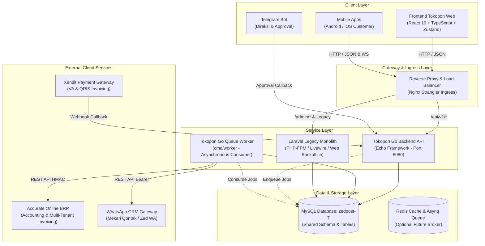

# 🏛️ Tokopon Ecosystem — System Architecture

> **Dokumen Arsitektur Sistem Terpadu Ekosistem Tokopon**  
> Baseline Audit: **22 Oktober 2026** | Status: **VERIFIED**

---

## 📌 1. Gambaran Umum Ekosistem

Ekosistem Tokopon dirancang menggunakan pola **Strangler Fig Pattern** untuk memigrasikan monolit Laravel secara bertahap menuju arsitektur backend Go Modular Monolith dan frontend Single Page Application (SPA) modern tanpa downtime operasional toko.



---

## 🏢 2. Multi-Tenancy & Business Unit Architecture

Ekosistem Tokopon menerapkan arsitektur **Column-Based Multi-Tenancy** (Single Database, Shared Tables) dengan kolom `business_unit_id` sebagai **Tenant Partition Key**.

### Pemetaan Business Unit Resmi:
| ID (`business_unit_id`) | Kode (`code`) | Nama Resmi | Karakteristik Bisnis & Prefix Nota | Cabang Operasional Utama |
|:---:|:---:|:---|:---|:---|
| **1** | `syihab` | **Syihab Store** | Smartphone Baru (Brand New), Aksesoris Original. Prefix: `POS-SYB-` | Banjarbaru, Martapura, Sultan Adam, Veteran, Premium |
| **2** | `second` | **GSK Second** | Smartphone Bekas (Second-Hand), Buyback, Trade-In, QC. Prefix: `POS-GSK-` | GSK Banjarbaru, GSK Kayutangi, GSK Martapura, GSK Sampit, GSK Sultan Adam, GSK Veteran |
| **3** | `distri` | **GSK Distri** | Grosir & Distribusi B2B Antar Cabang Rekanan. Prefix: `POS-DST-` | GSK Gudang Distribusi Pusat |

### Aturan Ketat Multi-Tenancy (Strict Invariant):
1. **Tenant Isolation:** Setiap query transaksi (`orders`, `cashier_shifts`, `warehouse_stocks`, `stock_opnames`) **WAJIB** memfilter `business_unit_id`.
2. **Master Data Shared-Global:** Data master seperti `brands`, `categories`, dan `branches` dapat bersifat spesifik tenant (`business_unit_id = X`) ATAU global jika `business_unit_id IS NULL`. Query wajib menggunakan pola:
   ```sql
   WHERE (business_unit_id = ? OR business_unit_id IS NULL)
   ```
3. **Multi-Database Accurate Dynamic Switching:** Setiap unit bisnis memiliki kredensial API Accurate mandiri (`accurate_host`, `accurate_token`, `accurate_secret_key`) yang disimpan di tabel `business_units`.
4. **Tenant Context Middleware:** Backend Go mengekstrak tenant dari JWT claim pengguna atau header `X-Business-Unit-Id` (khusus role eksekutif yang memiliki hak switch BU).

---

## 🧱 3. Arsitektur 3 Repository

### A. Monolit Legacy (`tokopon-zed-offline`)
- **Teknologi:** Laravel 11.x, PHP 8.2+, Livewire 3, AlpineJS, TailwindCSS, Spatie Laravel Permission, Laravel Sanctum / Fortify.
- **Tanggung Jawab Saat Ini:**
  - Menjaga integritas 238 migrasi database MySQL `zedpost-7`.
  - Melayani backoffice web legacy (`/admin/*`) dan halaman Livewire lama yang belum dipindahkan ke frontend modern.
  - Dokumentasi historis dan referensi kalkulasi komisi, diskon, dan skema accounting.

### B. Backend Modern (`tokopon-go`)
- **Teknologi:** Go 1.26+, Echo v4, `jmoiron/sqlx`, `go-sql-driver/mysql`, `gorilla/websocket`, `golang-jwt/jwt/v5`, `rs/zerolog`.
- **Pola Desain:** **Modular Monolith** dengan Clean Architecture pada setiap modul (`domain`, `repository`, `usecase`, `handler`, `service`).
- **8 Modul Modular Monolith:**
  1. `internal/modules/identity`: Autentikasi JWT, multi-tenant resolving, integrasi RBAC Spatie (`model_has_roles`, `role_has_permissions`).
  2. `internal/modules/pos`: POS kasir, shift management, serial number locking (`SELECT ... FOR UPDATE`), ESC/POS thermal layout, QZ Tray signing.
  3. `internal/modules/inventory`: Multi-warehouse stock breakdown, inbound PO receiving, stock opname fisik, stock adjustments.
  4. `internal/modules/catalog`: In-memory Promo Engine (kuota, multiplier, bundle max qty, diskon bertingkat), brands, categories.
  5. `internal/modules/loyalty`: Buku besar mutasi poin (1 poin = Rp 100), e-commerce coupons validation & usage limits.
  6. `internal/modules/tradein`: Retail trade-in & buyback calculation, QC checklist fatal evaluation, Digital Device Passport timeline seumur hidup IMEI.
  7. `internal/modules/integration`: Driver Accurate ERP, WhatsApp CRM gateway, Xendit webhook ingestion, Telegram inline approval, queue dispatcher.
  8. `internal/modules/analytics`: Agregasi omzet, tren penjualan, P&L laba rugi dengan HPP konsisten, audit selisih kas kasir, performa salesman.

### C. Frontend Modern (`tokopon-web`)
- **Teknologi:** React 19, TypeScript 5.8+, Vite 6, Tailwind CSS v4, Zustand 5, TanStack Query v5, Axios, React Hook Form + Zod, Lucide React.
- **Struktur Direktori:**
  - `src/api`: Axios instance dengan automatic refresh token interceptor, endpoint registry, dan central error handler.
  - `src/stores`: Zustand state stores (`authStore`, `shiftStore`, `cartStore`).
  - `src/components`: UI design system terpadu (`Button`, `Input`, `Badge`, `Card`, `Modal`).
  - `src/modules`: Modul halaman fitur (`identity`, `pos`, `home`, `inventory`, `tradein`, `analytics`).
  - `src/routes`: Protected routing dengan token lifecycle guard.

---

## 🗄️ 4. Kepemilikan Database (Database Ownership)

- **Database Name:** `zedpost-7` (MySQL 8.0 / MariaDB 10.4+).
- **Ownership Model:** **Shared Database, Shared Schema**.
- **Migration Authority:**
  - Migrasi master historis (tabel dasar 1–238) dikelola oleh Laravel di `database/migrations/`.
  - Backend Go menyediakan script migrasi SQL mandiri di `tokopon-go/migrations/` (000001 s/d 000008) yang 100% kompatibel dengan skema Laravel untuk kebutuhan deployment container mandiri di masa depan.
- **Concurrency & Data Consistency:**
  - Backend Go menggunakan transaksi pesimistik tingkat baris (`SELECT ... FOR UPDATE`) pada `warehouse_stocks`, `product_serial_numbers`, dan `cashier_shifts` untuk menjamin zero overselling pada saat checkout bersamaan.

---

## 🌐 5. Integrasi Eksternal (Third-Party Services)

1. **Accurate Online ERP:**
   - Protokol: HTTPS REST API dengan HMAC-SHA256 signature generator.
   - Entitas tersinkronisasi: Pelanggan baru (`/customer/save.do`), Faktur Penjualan (`/sales-invoice/save.do`), Penerimaan Penjualan (`/sales-receipt/save.do`).
   - Sifat: Asinkron melalui background queue worker dengan idempotency key di tabel `order_accurate_docs`.
2. **WhatsApp CRM Gateway:**
   - Protokol: HTTPS REST API ke gateway Tokopon CRM (`crm.tokopon.id`) dan Mekari Qontak.
   - Sifat: Asinkron dengan audit log di tabel `message_logs`.
3. **Xendit Payment Gateway:**
   - Protokol: Webhook callback (`POST /api/v1/webhooks/xendit`) dengan verifikasi `x-callback-token`.
   - Menangani invoice status `PAID`, `SETTLED`, dan `EXPIRED` (auto-cancel & restock).
4. **Telegram Bot Approvals (n8n):**
   - Protokol: Webhook callback (`POST /api/v1/webhooks/approval`) untuk otorisasi diskon khusus atau retur oleh C-Level via tombol inline keyboard Telegram.
5. **QZ Tray Printing:**
   - Protokol: Endpoint signing SHA-512 RSA (`POST /api/v1/pos/sign-qz`) untuk silent thermal receipt printing langsung ke hardware printer kasir tanpa dialog popup browser.

---

## 🚀 6. Topologi Deployment Produksi

```
                   Internet / Client Requests
                              │
                              ▼
                 [ Nginx Reverse Proxy: Port 80/443 ]
                 │                                  │
      ┌──────────┴──────────┐            ┌──────────┴──────────┐
      ▼                     ▼            ▼                     ▼
Static SPA Build      /api/v1/* Routes   /admin/* Routes   Websocket /ws/*
(tokopon-web dist)    (tokopon-go:8080)  (PHP-FPM Laravel) (tokopon-go:8080)
```

- **Stateless Backend:** Server Go dapat di-scale horizontal di belakang Nginx Load Balancer karena seluruh state sesi pengguna disimpan dalam JWT terenkripsi dan token refresh tersimpan di database.
- **Dedicated Queue Worker:** Binary `cmd/worker` dijalankan sebagai service systemd / container terpisah dari server HTTP utama agar pemrosesan sync Accurate dan WhatsApp tidak mengonsumsi resource request web kasir.
