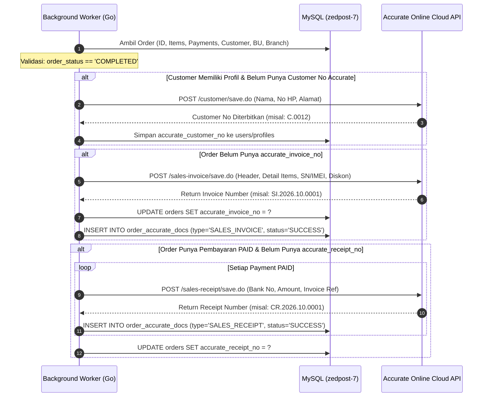

# Spesifikasi Arsitektur Step 2: Engine Sinkronisasi 2-Arah Accurate ERP & WhatsApp CRM Gateway

**Versi Dokumen:** 1.0  
**Tanggal:** 2026-10-19  
**Status:** DRAFT ARSITEKTUR & LANGKAH-LANGKAH KERJA (Belum Masuk Tahap Koding)  
**Referensi Source of Truth:**
- [`app/Services/AccurateService.php`](file:///c:/Users/ADVAN/Herd/tokopon-zed-offline/app/Services/AccurateService.php) (2.703 baris)
- [`app/Jobs/SyncOrderToAccurateJob.php`](file:///c:/Users/ADVAN/Herd/tokopon-zed-offline/app/Jobs/SyncOrderToAccurateJob.php)
- [`app/Services/CrmWhatsAppService.php`](file:///c:/Users/ADVAN/Herd/tokopon-zed-offline/app/Services/CrmWhatsAppService.php) (565 baris)
- [`app/Services/MessageDispatchService.php`](file:///c:/Users/ADVAN/Herd/tokopon-zed-offline/app/Services/MessageDispatchService.php)
- [`app/Models/OrderAccurateDoc.php`](file:///c:/Users/ADVAN/Herd/tokopon-zed-offline/app/Models/OrderAccurateDoc.php) & [`app/Models/MessageLog.php`](file:///c:/Users/ADVAN/Herd/tokopon-zed-offline/app/Models/MessageLog.php)

---

## 1. Pendahuluan & Tujuan Step 2

Pada tahap sebelumnya (Wave 1 - Wave 11), kita telah membangun seluruh antarmuka REST API dan WebSocket untuk kebutuhan Mobile App, Web POS Kasir, Gudang, Trade-In, Backoffice, dan Reporting. Namun, sistem operasional toko fisik belum dapat sepenuhnya melepaskan PHP karena **background automation kritikal** masih bertumpu pada Laravel:

1. **Accurate Online ERP Two-Way Synchronization:**
   - Setiap transaksi kasir toko atau pesanan online yang berstatus `COMPLETED` harus dicatat ke software akuntansi Accurate Online Cloud sebagai **Faktur Penjualan (Sales Invoice)** dan pelunasannya sebagai **Penerimaan Penjualan (Sales Receipt)**.
   - Jika unit diganti karena klaim garansi, sistem harus otomatis menerbitkan **Retur Penjualan (Sales Return)**.
   - Pengecekan stok dan validasi IMEI sebelum transaksi fisik bergantung pada database Accurate.
2. **WhatsApp CRM Notification & Struk Digital Gateway:**
   - Kasir POS tidak hanya mencetak struk thermal fisik, tetapi juga otomatis mengirimkan link/file struk digital WhatsApp ke nomor pelanggan.
   - Proses buyback, trade-in, dan update status klaim garansi mengirimkan notifikasi resmi melalui gateway WhatsApp CRM Zed Group / Qontak.

**Tujuan Step 2:**  
Mendokumentasikan seluruh aturan bisnis, formula payload, mekanisme autentikasi HMAC-SHA256, dan alur eksekusi di Laravel secara presisi sebelum diimplementasikan ke Go backend. **Tidak ada satu pun aturan bisnis Laravel yang boleh diubah atau dihilangkan.**

---

## 2. Bedah Logika Bisnis: Accurate Online ERP Integration

### 2.1 Manajemen Kredensial Multi-Tenant
Sistem Tokopon mendukung banyak unit bisnis (`business_units`) dengan database Accurate yang berbeda (contoh: database `syihab`, `second`, dll.).

**Aturan Bisnis Laravel:**
1. Kredensial dibaca dari tabel `business_units` berdasarkan kolom `code`:
   ```sql
   SELECT accurate_host, accurate_token, accurate_secret_key 
   FROM business_units 
   WHERE code = ? LIMIT 1;
   ```
2. Jika kode kosong, sistem menggunakan default: `'syihab'`.
3. Kredensial terdiri dari:
   - `accurate_host`: Base URL API Accurate Online (misal: `https://zeus.accurate.id/accurate/api`).
   - `accurate_token`: Bearer Access Token.
   - `accurate_secret_key`: Secret Key untuk menghitung digital signature.

### 2.2 Mekanisme Autentikasi & Tanda Tangan HMAC-SHA256
Setiap HTTP request ke API Accurate Online (baik GET maupun POST) diwajibkan menyertakan header tanda tangan kriptografi untuk mencegah pemalsuan (*tampering*):

**Formula Header:**
```
Authorization: Bearer <accurate_token>
X-Api-Timestamp: <ISO-8601 Timestamp, contoh: 2026-10-19T16:00:00+08:00>
X-Api-Signature: HMAC-SHA256(timestamp, accurate_secret_key)
Content-Type: application/json
```
- Request dilakukan dengan timeout 30 detik dan mekanisme retry otomatis sebanyak 2 kali (delay 500ms).
- Validasi Respons JSON Accurate:
  - Format sukses: `{"s": true, "d": ...}`
  - Format error: `{"s": false, "d": ["Pesan error dari Accurate"]}`

---

### 2.3 Alur Kerja Sinkronisasi Order Penjualan (Sales Invoice & Receipt)

Sesuai dengan [`SyncOrderToAccurateJob.php`](file:///c:/Users/ADVAN/Herd/tokopon-zed-offline/app/Jobs/SyncOrderToAccurateJob.php), alur terjadi saat transaksi berstatus `COMPLETED`:



#### Spesifikasi Payload Faktur Penjualan (`POST /sales-invoice/save.do`):
```json
{
  "customerNo": "CUST-0012",
  "branchName": "Banjarbaru Store",
  "transDate": "19/10/2026",
  "inclusiveTax": false,
  "taxable": false,
  "useTax1": false,
  "description": "Pesanan Mobile App #ORD-20261019-001 | Sales: Ahmad Fauzi",
  "cashDiscount": 50000,
  "detailItem": [
    {
      "itemNo": "APL-IP15PM-256",
      "warehouseName": "Gudang Utama Banjarbaru",
      "unitPrice": 21500000,
      "quantity": 1,
      "itemCashDiscount": 0,
      "salesmanListNumber": ["EMP-0012"],
      "detailSerialNumber": [
        {
          "serialNumberNo": "356789012345678",
          "quantity": 1
        }
      ]
    }
  ]
}
```

**Aturan Bisnis Kritis:**
1. **Diskon Item vs Diskon Header:**
   - Diskon per produk dimasukkan ke `itemCashDiscount` pada level baris item.
   - Diskon kupon e-commerce dan potongan loyalitas pelanggan dimasukkan ke `cashDiscount` pada level header faktur.
2. **Serial Number/IMEI:**
   - Jika order item memiliki serial number (`order_items.serial_number`), string dipisah berdasarkan koma, dibersihkan (*trimmed*), dan di-mapping ke array `detailSerialNumber` dengan `quantity: 1`.
3. **Pajak:**
   - Kolom `inclusiveTax`, `taxable`, dan `useTax1` bernilai `true` hanya jika unit bisnis memiliki bendera `business_units.is_taxable = 1`.

#### Spesifikasi Payload Penerimaan Penjualan (`POST /sales-receipt/save.do`):
```json
{
  "customerNo": "CUST-0012",
  "branchName": "Banjarbaru Store",
  "bankNo": "110101",
  "receiptAmount": 21450000,
  "chequeAmount": 21450000,
  "transDate": "19/10/2026",
  "description": "Pelunasan Pesanan #ORD-20261019-001",
  "detailInvoice": [
    {
      "invoiceNo": "SI.2026.10.0001",
      "paymentAmount": 21450000
    }
  ]
}
```
**Aturan Bisnis Kritis:**
- `bankNo`: Diambil dari `payment_methods.accurate_bank_no` (contoh: `110101` untuk Kas Tunai Toko, `110201` untuk Rekening Bank BCA). Jika kosong, fallback ke `'110101'`.

---

### 2.4 Alur Retur Penjualan Klaim Garansi (`POST /sales-return/save.do`)
Jika teknisi toko menyetujui penggantian unit garansi pada klaim (`warranty_claims`), Accurate harus:
1. Menarik unit rusak kembali ke gudang retur via Sales Return API.
2. Menerbitkan Sales Invoice baru untuk unit pengganti baru (dengan penyesuaian selisih harga jika upgrade tipe).

---

## 3. Bedah Logika Bisnis: WhatsApp CRM Notification Gateway

### 3.1 Gateway Switcher
Sistem mendukung 3 mode pengiriman melalui tabel `settings` (`whatsapp_active_gateway`):
1. `crm`: Gateway CRM WhatsApp Zed Group (Default utama).
2. `qontak`: Gateway resmi Qontak Omnichannel.
3. `none`: Menonaktifkan seluruh pengiriman pesan WhatsApp.

### 3.2 Format Standar Nomor Telepon (E.164 Indonesia)
Sesuai [`MessageDispatchService.php`](file:///c:/Users/ADVAN/Herd/tokopon-zed-offline/app/Services/MessageDispatchService.php):
- Hapus semua karakter non-angka (`+`, `-`, spasi, titik).
- `08123456789` -> diubah menjadi `628123456789`.
- `8123456789` -> diubah menjadi `628123456789`.
- `628123456789` -> dipertahankan.
- Jika panjang digit < 9 atau > 15 -> dianggap tidak valid.

---

### 3.3 Struktur Payload Pengiriman Struk Penjualan (`sendOrder`)

**Endpoint CRM:** `POST {CRM_WA_API_URL}/api/v1/broadcast/whatsapp`  
**Header:**
```
Authorization: Bearer {CRM_WA_TOKEN}
Accept: application/json
User-Agent: ZedPOS/1.0
```

**Payload JSON:**
```json
{
  "transaction_id": "ORD-20261019-001",
  "to_name": "Budi Santoso",
  "to_number": "628123456789",
  "message_template_id": "380d1355-0a65-4dc5-be82-308ee7619910",
  "channel_integration_id": "56b60c3c-0123-46af-958b-32f3ad12ee37",
  "language": {
    "code": "id"
  },
  "parameters": {
    "header": {
      "format": "DOCUMENT",
      "params": [
        {
          "key": "url",
          "value": "https://pos.tokopon.id/storage/receipts/struk-ORD-20261019-001.pdf"
        },
        {
          "key": "filename",
          "value": "struk-ORD-20261019-001.pdf"
        }
      ]
    },
    "body": [
      {
        "key": "1",
        "value": "nama",
        "value_text": "Budi Santoso"
      },
      {
        "key": "2",
        "value": "nota",
        "value_text": "ORD-20261019-001"
      },
      {
        "key": "3",
        "value": "total",
        "value_text": "Rp 21.450.000"
      }
    ]
  }
}
```

### 3.4 Pencatatan Audit Trail (`message_logs`)
Setiap pengiriman pesan (berhasil maupun gagal) **wajib** dicatat ke tabel `message_logs`:
- `channel`: `'whatsapp'`
- `recipient`: Nomor HP tujuan
- `recipient_name`: Nama pelanggan
- `subject`: `'Struk Penjualan #' . order_number`
- `message_type`: `'receipt_order'`
- `content`: Ringkasan teks transaksi
- `attachment_url`: URL file struk
- `payload`: JSON payload lengkap yang dikirim ke gateway
- `response_payload`: Respons balik dari gateway
- `is_sent`: boolean (`1` jika HTTP 200, `0` jika gagal)
- `status`: `'sent'` / `'failed'`
- `error_message`: Pesan kegagalan jika ada
- `reference_number`: Nomor nota order
- `sent_by`: ID user kasir/staf
- `business_unit_id` & `branch_id`

Jika sukses terkirim, sistem mengupdate tabel order:
```sql
UPDATE orders SET is_wa_sent = 1 WHERE id = ?;
```

---

## 4. Rancangan Arsitektur Go untuk Step 2

Modul ini akan ditempatkan pada paket integrasi mandiri di dalam repositori `tokopon-go`:

```
tokopon-go/
├── internal/
│   ├── integration/
│   │   ├── accurate/
│   │   │   ├── client.go           # HTTP Client dengan auto HMAC-SHA256 Signature
│   │   │   ├── customer.go         # Sync Customer & Check Customer No
│   │   │   ├── sales_invoice.go    # Buat Faktur Penjualan (/sales-invoice/save.do)
│   │   │   ├── sales_receipt.go    # Buat Penerimaan Penjualan (/sales-receipt/save.do)
│   │   │   ├── sales_return.go     # Buat Retur Penjualan klaim garansi
│   │   │   └── item_sync.go        # Cek serial number & import katalog
│   │   └── whatsapp/
│   │       ├── client.go           # HTTP Client ke CRM WhatsApp & Qontak
│   │       ├── formatter.go        # Normalisasi nomor telepon standar Indonesia
│   │       ├── dispatcher.go       # SendOrderReceipt, SendBuybackOTP, dll
│   │       └── logger.go           # Repository insert/update ke message_logs
│   └── worker/
│       ├── accurate_sync_worker.go # Consumer antrian 'job:order:sync_accurate'
│       └── whatsapp_worker.go      # Consumer antrian 'job:notification:whatsapp'
```

---

## 5. Rencana Langkah Kerja Bertahap (Roadmap Step 2)

| Tahap | Modul / Pekerjaan | Target Luaran |
|:---:|:---|:---|
| **Step 2.1** | **Spesifikasi Dokumen & Review Logika Bisnis** | ✅ **Selesai (Dokumen ini)** |
| **Step 2.2** | **Accurate HMAC Client & DTO di Go** | HTTP client Go dengan kalkulasi tanda tangan HMAC-SHA256 dan pembaca kredensial multi-tenant dari DB |
| **Step 2.3** | **Order Sync Service (Invoice + Receipt)** | Logic Go untuk mengubah data pesanan menjadi Sales Invoice & Sales Receipt di Accurate Cloud |
| **Step 2.4** | **WhatsApp CRM Client & Message Logger** | HTTP client WhatsApp CRM, parser nomor telepon, dan pencatat audit log ke tabel `message_logs` |
| **Step 2.5** | **Worker Consumer Integration** | Integrasi dengan Queue Broker Go (`database`/`redis`) untuk memproses sinkronisasi secara asynchronous tanpa membuat checkout kasir lag |
| **Step 2.6** | **Go Native Unit Testing & Behavioral Parity** | Pengujian unit dengan `httptest` memvalidasi payload JSON dan respons kode setara 100% dengan Laravel |

---

## 6. Pertanyaan Konfirmasi untuk User Sebelum Memulai

Sebelum kita mulai menulis kode pada **Step 2.2**:
1. Apakah struktur payload Faktur Accurate dan template pesan WhatsApp di atas sudah sesuai dengan alur bisnis yang berjalan di toko fisik saat ini?
2. Apakah sinkronisasi Accurate saat kasir checkout offline ingin dijalankan secara asynchronous (*background queue*) agar transaksi kasir tetap instan seketika?

Jika dokumen langkah-langkah ini sudah disetujui, kita siap melangkah ke tahap implementasi kode! 🚀
