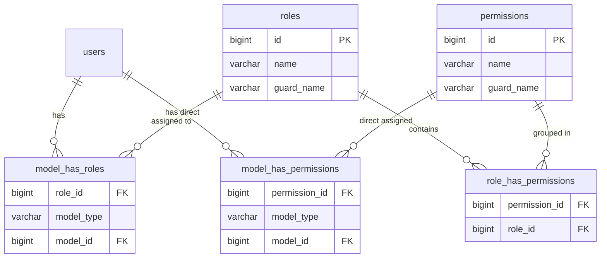

# Evaluasi & Desain Paritas: Laravel Spatie Permission vs Go RBAC

**Versi Dokumen:** 1.0  
**Tanggal:** 2026-10-19  
**Status:** DOKUMEN ANALISIS & DESAIN ARSITEKTUR 📋  
**Target:** Menyelaraskan otorisasi peran (*Role*) dan izin granular (*Permission*) Spatie Laravel existing ke dalam Go Backend tanpa mengubah skema database MySQL `zedpost-7`.

---

## 1. Pertanyaan Kunci & Status Evaluasi Saat Ini

> **Pertanyaan User:**  
> *"Di Laravel saya menggunakan Laravel Spatie Permission kan, di Go bagaimana? Apakah sudah di-handle?"*

### Jawaban Singkat & Status Riil:
- **Level ROLE (Peran Kasar): SUDAH DITANGANI (80% SIAP) ✅**  
  Pada Wave 1 (`tokopon-go/internal/repository/user_repository.go`), Go **sudah langsung membaca tabel Spatie `roles` dan `model_has_roles`** dari database `zedpost-7`. Role dimasukkan ke token JWT (`claims.Roles`) dan diverifikasi melalui middleware `RequireRole("superadmin", "admin", "director")`.
- **Level PERMISSION (Izin Granular): BELUM DITANGANI PENUH (20% GAP) ⚠️**  
  Laravel di `routes/web.php` menggunakan lebih dari **30 izin spesifik** dengan middleware `can:view-pos`, `can:manage-users`, `can:manage-inbound`, `can:view-reporting`, dll. Di Go saat ini, kita **baru mengecek Role pengguna, belum mengecek Permission granular**. Jika seorang kasir atau teknisi diberi izin custom tanpa role admin penuh, Go saat ini belum memiliki filter izin level individu tersebut.

---

## 2. Bedah Arsitektur Spatie Permission di Laravel Existing

Laravel menggunakan package `spatie/laravel-permission: ^7.2` dengan trait `HasRoles` pada model `App\Models\User`.

### 2.1 Skema Tabel di Database `zedpost-7`
Spatie menggunakan 5 tabel relasional yang saling terhubung:



### 2.2 Daftar 32 Izin Aktif di Laravel (`can:*`)
Berdasarkan audit rute [`routes/web.php`](file:///c:/Users/ADVAN/Herd/tokopon-zed-offline/routes/web.php), berikut izin granular yang mengontrol akses staf:

| Modul Operasional | Permission Spatie di Laravel | Rute yang Dilindungi |
|---|---|---|
| **Kasir Toko Fisik** | `view-pos` | `/zoffline/pos`, `/open-shift`, `/closing-kasir`, `/riwayat` |
| **Audit Kasir** | `monitoring-kasir` | `/zoffline/monitoring-kasir` |
| **Audit Kasir Lanjutan** | `view-riwayat-kasir` | `/zoffline/riwayat-kasir` |
| **Trade-In Retail** | `trade-in` | `/zoffline/trade-in` |
| **Buyback HP Bekas** | `sell-phone` | `/zoffline/sell-phone` |
| **Riwayat Buyback** | `sell-phone-history` | `/zoffline/sell-phone-history` |
| **Aktivasi Garansi** | `warranty-activation` | `/zoffline/warranty-activation`, `/warranty-claim` |
| **Stok Toko & Cabang** | `view-stock` | `/zoffline/cek-stock`, `/pemakaian-inventaris` |
| **Stok Gudang & SN** | `view-warehouse-stocks` | `/zoffline/check-serial-number`, `/sn-history` |
| **Inbound PO Gudang** | `manage-inbound` | `/zoffline/inbound`, `/inbound/{po}/scan` |
| **Live Chat CS** | `access-cs-chat` | `/zoffline/cs-chat`, `/zoffline/ecommerce/*` |
| **Laporan Toko** | `view-reporting` | `/reporting/sales`, `/profit`, `/pembelian`, dll |
| **Aturan Approval** | `manage-settings` | `/zoffline/approval-rules`, `/settings/*` |
| **Manajemen User** | `manage-users` | `/admin/users`, `/admin/roles`, `/admin/user/employes` |
| **Katalog Produk Baru** | `manage-new-catalog` | `/admin/products`, `/products/{id}/variants` |
| **Katalog HP Bekas** | `manage-second-catalog` | `/admin/second-products` |
| **Kategori & Brand** | `manage-categories`, `manage-brands` | `/admin/categories`, `/admin/brands` |
| **Integrasi Accurate** | `manage-accurate-products` | `/admin/accurate-products`, `/accurate-sync-sn` |
| **Customer Accurate** | `manage-accurate-customers` | `/admin/accurate-customers` |
| **Pesanan Backoffice** | `manage-orders` | `/admin/orders`, `/sales-orders/*` |
| **Dashboard Eksekutif**| `view_dashboard` | `/admin/dashboard` |

---

## 3. Analisis Gap: Apa yang Kurang di Go Saat Ini?

### Kondisi Implementasi Go Saat Ini:
1. **Repository Go Saat Ini:**
   ```sql
   -- Hanya membaca role:
   SELECT r.name 
   FROM roles r 
   INNER JOIN model_has_roles m ON r.id = m.role_id 
   WHERE m.model_id = ? AND (m.model_type = 'App\\Models\\User' OR m.model_type = 'User');
   ```
2. **Middleware Go Saat Ini:**
   ```go
   // Hanya bisa membatasi berdasarkan role:
   RequireRole("superadmin", "admin", "director")
   ```

### Masalah Nyata di Toko Fisik Jika Hanya Mengandalkan Role:
1. **User Role `cashier` atau `staff`**:  
   Di toko offline, seorang staf kasir tidak memiliki role `admin`. Di Spatie Laravel, user tersebut diberi role `staff` lalu di-assign permission `view-pos` dan `sell-phone`. Jika Go hanya mengecek `RequireRole("admin")`, staf kasir akan terblokir (*403 Forbidden*), atau jika kita izinkan role `staff` ke seluruh endpoint POS, staf kasir bisa mengakses hal-hal yang tidak diizinkan.
2. **SuperAdmin Bypass:**  
   Di Laravel, user dengan role `superadmin` otomatis memiliki hak akses ke seluruh permission tanpa perlu di-assign satu per satu. Di Go, logika bypass ini harus dipasang secara eksplisit di level middleware.

---

## 4. Desain Solusi Go: Spatie Permission Parity Engine

Untuk menyamai kemampuan Spatie Permission 100% tanpa mengubah database, kita mengimplementasikan **Dual-Layer RBAC Engine** di Go:

### 4.1 SQL Unified Permission Resolver
Go akan mengekstrak seluruh permission aktif seorang user, baik yang didapat dari **Role (Inherited)** maupun dari **Penugasan Langsung (Direct Permission)** dalam satu kueri efisien:

```sql
-- Kueri Ekstraksi Hak Akses Lengkap Spatie di Go
SELECT DISTINCT p.name
FROM permissions p
WHERE p.id IN (
    -- 1. Permission yang diwarisi melalui Role pengguna
    SELECT rhp.permission_id
    FROM role_has_permissions rhp
    INNER JOIN model_has_roles mhr ON rhp.role_id = mhr.role_id
    WHERE mhr.model_id = ? 
      AND (mhr.model_type = 'App\\Models\\User' OR mhr.model_type = 'User')

    UNION

    -- 2. Permission langsung yang ditempelkan ke User
    SELECT mhp.permission_id
    FROM model_has_permissions mhp
    WHERE mhp.model_id = ? 
      AND (mhp.model_type = 'App\\Models\\User' OR mhp.model_type = 'User')
);
```

### 4.2 Pembaruan JWT Claims & User DTO
Token JWT yang diterbitkan saat login akan membawa array `Roles` dan array `Permissions`:

```go
type CustomClaims struct {
    UserID         int64    `json:"user_id"`
    Email          string   `json:"email"`
    Name           string   `json:"name"`
    Roles          []string `json:"roles"`       // contoh: ["staff", "cashier"]
    Permissions    []string `json:"permissions"` // contoh: ["view-pos", "sell-phone", "view-stock"]
    BusinessUnitID *int64   `json:"business_unit_id,omitempty"`
    BranchID       *int64   `json:"branch_id,omitempty"`
    jwt.RegisteredClaims
}
```

### 4.3 Implementasi Middleware `RequirePermission` di Go
Ekuivalen persis dengan `middleware('can:view-pos')` di Laravel:

```go
// RequirePermission memeriksa apakah user memiliki salah satu permission ATAU berstatus superadmin
func RequirePermission(allowedPermissions ...string) echo.MiddlewareFunc {
    return func(next echo.HandlerFunc) echo.HandlerFunc {
        return func(c echo.Context) error {
            claims := GetAuthenticatedUser(c)
            if claims == nil {
                return response.Error(c, http.StatusUnauthorized, "UNAUTHORIZED", "Akses tidak diotorisasi")
            }

            // 1. SuperAdmin Wildcard Bypass (Perilaku identik Gate::before di Laravel)
            for _, role := range claims.Roles {
                if strings.EqualFold(role, "superadmin") {
                    return next(c)
                }
            }

            // 2. Cek apakah user memiliki salah satu izin yang diminta
            for _, required := range allowedPermissions {
                for _, userPerm := range claims.Permissions {
                    if strings.EqualFold(userPerm, required) {
                        return next(c)
                    }
                }
            }

            return response.Error(c, http.StatusForbidden, "FORBIDDEN", 
                "Anda tidak memiliki izin (permission) untuk mengakses fitur ini")
        }
    }
}
```

---

## 5. Tabel Mapping Ekuivalensi: Laravel vs Go

| Fitur / Pengecekan | Cara di Laravel (Spatie) | Cara di Go Backend (`tokopon-go`) |
|---|---|---|
| **Cek Role di Route** | `->middleware('role:admin\|director')` | `middleware.RequireRole("admin", "director")` |
| **Cek Permission di Route** | `->middleware('can:view-pos')` | `middleware.RequirePermission("view-pos")` |
| **Cek Multi-Permission (OR)** | `->middleware('can:view-pos\|manage-orders')` | `middleware.RequirePermission("view-pos", "manage-orders")` |
| **Bypass SuperAdmin** | `Gate::before(fn($u) => $u->hasRole('superadmin'))` | Otomatis di-bypass di dalam `RequirePermission` |
| **Cek Izin di Controller/Logic** | `Auth::user()->can('view-reporting')` | `claims.HasPermission("view-reporting")` |
| **Cek Role di Controller/Logic** | `Auth::user()->hasRole('cashier')` | `claims.HasRole("cashier")` |
| **Sumber Data DB** | Tabel Spatie (`roles`, `permissions`, `model_has_*`) | **Tabel Spatie yang sama persis (100% Shared)** |

---

## 6. Rencana Langkah Implementasi di Go

Pekerjaan ini sangat cepat dan aman karena database sudah tersedia:

1. **Step P.1 (User Repository):**  
   Tambahkan fungsi `GetPermissionsByUserID(ctx, userID int64) ([]string, error)` di [`tokopon-go/internal/repository/user_repository.go`](file:///c:/Users/ADVAN/Herd/tokopon-zed-offline/tokopon-go/internal/repository/user_repository.go) menggunakan SQL union resolver di atas.
2. **Step P.2 (JWT & Auth UseCase):**  
   Perbarui [`pkg/auth/jwt.go`](file:///c:/Users/ADVAN/Herd/tokopon-zed-offline/tokopon-go/pkg/auth/jwt.go) agar `CustomClaims` memuat field `Permissions []string`, dan panggil saat proses login di `auth_usecase.go`.
3. **Step P.3 (Auth Middleware):**  
   Tambahkan fungsi `RequirePermission(perms ...string)` dan helper `claims.HasPermission(p string)` di [`auth_middleware.go`](file:///c:/Users/ADVAN/Herd/tokopon-zed-offline/tokopon-go/internal/delivery/http/middleware/auth_middleware.go).
4. **Step P.4 (Route Protection):**  
   Pasang middleware `RequirePermission` pada endpoint sensitif:
   - POS: `RequirePermission("view-pos")`
   - Inbound: `RequirePermission("manage-inbound")`
   - Inventory: `RequirePermission("view-stock")`
   - Reporting: `RequirePermission("view-reporting")`
   - Master Data: `RequirePermission("manage-settings")`
5. **Step P.5 (Unit Testing):**  
   Uji dengan Go native test: verifikasi user biasa tanpa permission ditolak (*403 Forbidden*), user dengan permission diizinkan (*200 OK*), dan superadmin selalu lolos (*Bypass 200 OK*).

---

## 7. Kesimpulan

Dengan mengadopsi rancangan di dokumen ini:
1. **Tidak perlu mengubah database sama sekali:** Go langsung membaca tabel Spatie yang sudah ada.
2. **Kompatibel dua arah:** Jika admin mengubah role/permission user di dashboard Livewire lama, perubahan tersebut langsung berlaku seketika di Go backend.
3. **Keamanan presisi:** Kasir, teknisi, salesman, dan manajer toko cabang hanya dapat mengakses endpoint API yang memang menjadi hak mereka.
