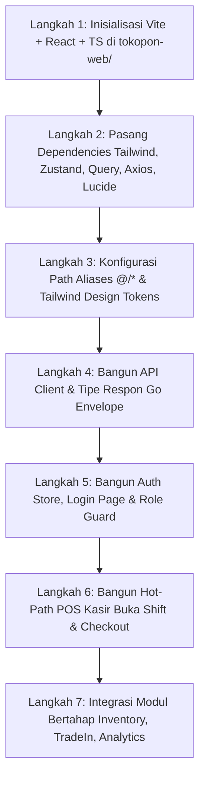

# 36 — Panduan Lengkap Scaffolding & Arsitektur Frontend (`tokopon-web`)

**Tanggal:** 22 Oktober 2026  
**Status:** DRAFT ARSITEKTUR & PANDUAN IMPLEMENTASI ✅  
**Target Direktori:** `tokopon-web/` (Root Project Workspace)  
**Target Produksi:** 1 Server Frontend (Nginx Static SPA) $\leftrightarrow$ Load Balancer $\leftrightarrow$ 2 Server Backend Go (Horizontal Scaling)  

---

## 1. Visi Arsitektur & Topologi Deployment

Frontend Tokopon dirancang sebagai **Single-Page Application (SPA) Modern** berbasis **Vite + React 19 + TypeScript**, yang sepenuhnya terpisah (*decoupled*) dari backend Go.

### Topologi Produksi (3 Server)
```
                          [ KASIR / USER / MOBILE BROWSER ]
                                         │
                       ┌─────────────────┴─────────────────┐
                       │                                   │
             Request UI (HTML/JS/Assets)          Request API (/api/v1/*)
                       │                                   │
                       ▼                                   ▼
             ┌──────────────────┐               ┌─────────────────────┐
             │   SERVER 1: FE   │               │   LOAD BALANCER     │
             │  (Nginx / Vite)  │               │   (Nginx / HAProxy) │
             │  Port: 80 / 443  │               └──────────┬──────────┘
             └──────────────────┘                          │
                                              ┌────────────┴────────────┐
                                        least_conn / Round-Robin
                                              │                         │
                                              ▼                         ▼
                                    ┌──────────────────┐      ┌──────────────────┐
                                    │  SERVER 2: BE-1  │      │  SERVER 3: BE-2  │
                                    │   (Tokopon Go)   │      │   (Tokopon Go)   │
                                    │   192.168.1.11   │      │   192.168.1.12   │
                                    └─────────┬────────┘      └─────────┬────────┘
                                              │                         │
                                              └────────────┬────────────┘
                                                           │
                                                           ▼
                                               ┌───────────────────────┐
                                               │      SHARED DB        │
                                               │  (MySQL 'zedpost-7')  │
                                               └───────────────────────┘
```

### Keuntungan Utama Pola Ini:
1. **Independent Release Cycle:** Update tampilan antarmuka kasir tidak memerlukan restart pada service backend Go.
2. **High Availability & Failover:** Jika server `BE-1` mengalami restart/pembaruan, load balancer otomatis mengalihkan semua transaksi kasir ke `BE-2` tanpa adanya downtime toko.
3. **Optimized Client Performance:** Seluruh aset frontend di-cache secara permanen di browser klien/kasir (*Cache-Control: immutable*).

---

## 2. Tech Stack Rekomendasi Frontend

| Kategori | Teknologi Pilihan | Alasan & Peran |
|---|---|---|
| **Build Tool** | **Vite 6** | Waktu *Hot Module Replacement* (HMR) <50ms dan bundling produksi super ringkas via Rollup. |
| **Framework & Bahasa** | **React 19 + TypeScript 5.7** | Ekosistem library retail/barcode scanner paling matang dengan pengetikan statis ketat. |
| **Routing** | **React Router v7** | Routing deklaratif dengan dukungan *Role Guard* dan *Nested Layouts*. |
| **State Management (Client)** | **Zustand 5** | Manajemen state lokal in-memory (Cart belanja kasir, sesi shift aktif, user profile) tanpa boilerplate. |
| **State Management (Server)** | **TanStack Query v5 (React Query)** | Pengambilan data API otomatis, caching cerdas, deduplikasi request, dan auto-refetch. |
| **HTTP Client** | **Axios 1.7** | Interceptor terpusat untuk injeksi token JWT, auto-refresh token 401, dan penanganan error standar Go Envelope. |
| **Styling & Icons** | **Tailwind CSS v4 + Lucide React** | Desain utility-first responsif, dark mode, dan ikon modern tanpa overhead runtime CSS. |
| **Komponen UI Primitif** | **Headless UI / Radix Primitives** | Komponen aksesibel (Modal/Dialog, Dropdown, Tabs) yang fleksibel tanpa styling bawaan kaku. |
| **Form & Validasi** | **React Hook Form + Zod** | Validasi payload form checkout & transaksi retail dengan performa re-render minimal. |
| **Integrasi Hardware POS** | **QZ Tray + Web Audio** | Silent printing struk thermal ESC/POS 40-kolom dan audio feedback (beep sukses scan barcode). |

---

## 3. Struktur Direktori Terstruktur (`tokopon-web/`)

Struktur folder mengadopsi prinsip **Domain-Driven Module Mirroring** (mencerminkan 8 modul backend Go):

```text
tokopon-web/
├── index.html                     # Entrypoint HTML (viewport, font Inter)
├── vite.config.ts                 # Konfigurasi Vite & proxy backend lokal
├── tsconfig.json                  # Konfigurasi TypeScript strict mode & path alias @/*
├── tailwind.config.js             # Tema warna Tokopon, font, & breakpoint
├── package.json                   # Metadata dependencies
├── .env.development               # VITE_API_BASE_URL=http://localhost:8080/api/v1
├── .env.production                # VITE_API_BASE_URL=https://app.tokopon.id/api/v1
├── public/
│   ├── favicon.ico
│   └── sounds/
│       ├── beep-success.mp3       # Bunyi konfirmasi scan barcode
│       └── beep-error.mp3         # Bunyi serial number tidak ditemukan/invalid
└── src/
    ├── main.tsx                   # Bootstrapper React & Provider Root
    ├── App.tsx                    # Root Component & Global QueryClientProvider
    │
    ├── api/                       # 🌐 CENTRAL HTTP & API CLIENT
    │   ├── client.ts              # Axios instance, Bearer token injection & 401 refresh interceptor
    │   ├── envelope.ts            # Tipe TypeScript standar respon Go (Envelope, Meta, ErrorResponse)
    │   └── endpoints.ts           # Konstanta URL endpoint seluruh modul
    │
    ├── assets/                    # Gambar, logo Tokopon, ilustrasi SVG
    │
    ├── components/                # 🧩 SHARED UI COMPONENTS
    │   ├── ui/                    # Button, Input, Card, Badge, Modal, Table, Dropdown
    │   ├── feedback/              # Toast notification, LoadingSpinner, ConfirmDialog
    │   └── pos/                   # BarcodeInputWedge, CashDenominationInput, ReceiptPreview
    │
    ├── hooks/                     # 🪝 REUSABLE CUSTOM HOOKS
    │   ├── useBarcodeScanner.ts   # Tangkap input barcode scanner USB tanpa delay keyboard
    │   ├── useThermalPrint.ts     # Integrasi silent print QZ Tray & Web Print fallback
    │   ├── useWebSocketChat.ts    # Koneksi realtime chat CS dengan auto-reconnect
    │   └── useDebounce.ts         # Debounce pencarian produk/stok
    │
    ├── layouts/                   # 🖼️ APPLICATION LAYOUTS
    │   ├── AuthLayout.tsx         # Layout halaman Login & Switch Business Unit
    │   ├── AppLayout.tsx          # Layout dashboard standar (Sidebar + Topbar Admin/Manager)
    │   └── PosLayout.tsx          # Layout khusus kasir toko (Full-screen, tanpa sidebar distraksi)
    │
    ├── modules/                   # 📦 FEATURE MODULES (1:1 MIRROR BACKEND GO)
    │   ├── identity/              # [MOD-01] Halaman Login, Ganti Password, Switch Business Unit
    │   │   ├── pages/LoginPage.tsx
    │   │   ├── pages/SwitchBUModal.tsx
    │   │   └── hooks/useAuth.ts
    │   │
    │   ├── pos/                   # [MOD-02] ⚡ CORE POS KASIR (HOT PATH)
    │   │   ├── pages/ActiveShiftPage.tsx      # Open Shift & hitung modal awal
    │   │   ├── pages/CheckoutPage.tsx         # Cart, scan barcode, split payment, voucher
    │   │   ├── pages/CloseShiftPage.tsx        # Rekonsiliasi kas (balanced/over/short)
    │   │   └── components/CartItemList.tsx
    │   │
    │   ├── inventory/             # [MOD-03] Manajemen Stok & Gudang
    │   │   ├── pages/StockOverviewPage.tsx    # Cek stok multi-gudang
    │   │   ├── pages/StockOpnamePage.tsx      # Opname fisik scan IMEI
    │   │   └── pages/InboundPOPage.tsx        # Penerimaan PO supplier
    │   │
    │   ├── catalog/               # [MOD-04] Produk & Promo Engine
    │   │   ├── pages/ProductListPage.tsx      # Manajemen katalog produk
    │   │   └── pages/PromoManagementPage.tsx  # Setup kuota diskon & bundling
    │   │
    │   ├── loyalty/               # [MOD-05] CRM & Loyalitas Member
    │   │   ├── pages/MemberSearchModal.tsx    # Lookup pelanggan kasir & poin
    │   │   └── pages/CouponVoucherPage.tsx    # Manajemen voucher toko
    │   │
    │   ├── tradein/               # [MOD-06] Trade-In, Buyback & Passport
    │   │   ├── pages/TradeInFormPage.tsx      # Form kalkulasi tukar tambah
    │   │   ├── pages/BuybackAppraisalPage.tsx # Taksiran harga HP bekas
    │   │   ├── pages/QCInspectionPage.tsx     # Checklist QC teknisi toko
    │   │   └── pages/DevicePassportPage.tsx   # Riwayat seumur hidup IMEI
    │   │
    │   ├── integration/           # [MOD-07] Gateway & Integration Monitor
    │   │   ├── pages/AccurateSyncPage.tsx     # Audit dokumen invoice Accurate ERP & retry
    │   │   └── pages/WhatsAppLogPage.tsx      # Log pengiriman struk digital WA
    │   │
    │   └── analytics/             # [MOD-08] Dashboard Eksekutif & Finansial
    │       ├── pages/ExecutiveDashboard.tsx   # KPI Cards, Sales Trend Chart, Pangsa Cabang
    │       ├── pages/ShiftAuditReportPage.tsx # Laporan rekonsiliasi kas kasir
    │       └── pages/ProfitLossReportPage.tsx # Laporan Laba Rugi P&L
    │
    ├── routes/                    # 🚦 ROUTER & ROLE GUARDS
    │   ├── index.tsx              # Definisi seluruh rute aplikasi
    │   └── ProtectedRoute.tsx     # Guard izin peran (superadmin, cashier, admin, director)
    │
    ├── stores/                    # 🗄️ CLIENT STATE (ZUSTAND)
    │   ├── authStore.ts           # Token JWT, data user, permissions
    │   ├── tenantStore.ts         # Business Unit & Cabang toko aktif
    │   ├── cartStore.ts           # State keranjang belanja POS kasir
    │   └── shiftStore.ts          # Shift kasir aktif saat ini
    │
    └── utils/                     # 🛠️ HELPER & FORMATTER
        ├── currency.ts            # formatRupiah(14999000) -> "Rp 14.999.000"
        ├── date.ts                # formatDateIndo, parseDateRange
        └── escpos.ts              # ESC/POS byte generator & printer helper
```

---

## 4. Rincian Konfigurasi Kunci

### 4.1 Axios Interceptor dengan Auto-Refresh Token (`src/api/client.ts`)
```typescript
import axios from 'axios';
import { useAuthStore } from '@/stores/authStore';

export const apiClient = axios.create({
  baseURL: import.meta.env.VITE_API_BASE_URL || 'http://localhost:8080/api/v1',
  headers: {
    'Content-Type': 'application/json',
  },
  timeout: 10000,
});

// Request Interceptor: Injeksi Access Token
apiClient.interceptors.request.use((config) => {
  const token = useAuthStore.getState().accessToken;
  if (token) {
    config.headers.Authorization = `Bearer ${token}`;
  }
  return config;
});

// Response Interceptor: Tangani 401 Unauthorized secara Otomatis
apiClient.interceptors.response.use(
  (response) => response,
  async (error) => {
    const originalRequest = error.config;
    if (error.response?.status === 401 && !originalRequest._retry) {
      originalRequest._retry = true;
      try {
        const refreshToken = useAuthStore.getState().refreshToken;
        if (!refreshToken) throw new Error('No refresh token');

        const { data } = await axios.post(`${apiClient.defaults.baseURL}/auth/refresh`, {
          refresh_token: refreshToken,
        });

        useAuthStore.getState().setTokens(data.data.access_token, data.data.refresh_token);
        originalRequest.headers.Authorization = `Bearer ${data.data.access_token}`;
        return apiClient(originalRequest);
      } catch (refreshErr) {
        useAuthStore.getState().logout();
        window.location.href = '/login';
        return Promise.reject(refreshErr);
      }
    }
    return Promise.reject(error);
  }
);
```

### 4.2 State Keranjang Kasir POS Cepat (`src/stores/cartStore.ts`)
```typescript
import { create } from 'zustand';

export interface CartItem {
  product_variant_id: number;
  product_name: string;
  price: number;
  qty: number;
  serial_numbers: string[];
}

interface CartState {
  items: CartItem[];
  addItem: (item: CartItem) => void;
  removeItem: (variantId: number) => void;
  updateQty: (variantId: number, qty: number) => void;
  clearCart: () => void;
  getSubtotal: () => number;
}

export const useCartStore = create<CartState>((set, get) => ({
  items: [],
  addItem: (newItem) => set((state) => {
    const existing = state.items.find(i => i.product_variant_id === newItem.product_variant_id);
    if (existing) {
      return {
        items: state.items.map(i =>
          i.product_variant_id === newItem.product_variant_id
            ? { ...i, qty: i.qty + newItem.qty, serial_numbers: [...i.serial_numbers, ...newItem.serial_numbers] }
            : i
        ),
      };
    }
    return { items: [...state.items, newItem] };
  }),
  removeItem: (variantId) => set((state) => ({
    items: state.items.filter(i => i.product_variant_id !== variantId),
  })),
  updateQty: (variantId, qty) => set((state) => ({
    items: state.items.map(i => i.product_variant_id === variantId ? { ...i, qty } : i),
  })),
  clearCart: () => set({ items: [] }),
  getSubtotal: () => get().items.reduce((total, i) => total + (i.price * i.qty), 0),
}));
```

---

## 5. Alur Tahapan Eksekusi Scaffolding (Runbook)

Berikut adalah urutan langkah demi langkah saat kita mulai membangun `tokopon-web/`:



1. **Langkah 1: Inisialisasi Proyek**
   Jalankan pembuatan template Vite di folder `tokopon-web/`.
2. **Langkah 2: Instalasi Dependensi**
   Pasang paket utama: `axios`, `zustand`, `@tanstack/react-query`, `react-router-dom`, `lucide-react`, `zod`, `react-hook-form`, `tailwind`.
3. **Langkah 3: Konfigurasi Lingkungan & Proxy**
   Setup `vite.config.ts` dengan alias `@` dan proxy lokal ke backend Go `http://localhost:8080`.
4. **Langkah 4: Setup API & Auth Foundation**
   Implementasi `src/api/client.ts` dan `src/stores/authStore.ts` untuk menangani otentikasi login staf kasir.
5. **Langkah 5: Bangun Hot Path Kasir POS**
   Implementasi layar kasir: Buka Shift kasir, Katalog produk, Keranjang in-memory, Checkout pembayaran, dan Struk thermal.
6. **Langkah 6: Pengujian Integrasi 2 Backend**
   Validasi integrasi dengan menyalakan backend Go dan memverifikasi panggilan API berjalan mulus tanpa CORS issue.

---

## 6. Konfigurasi Nginx untuk Server Produksi (Horizontal Scaling)

Ketika masuk ke server produksi dengan **1 server Frontend dan 2 server Backend Go**:

```nginx
# /etc/nginx/sites-available/tokopon.conf

upstream tokopon_backend {
    least_conn; # Kirim traffic ke server backend dengan koneksi aktif paling sedikit
    server 192.168.1.11:8080 max_fails=3 fail_timeout=10s; # Backend Go 1
    server 192.168.1.12:8080 max_fails=3 fail_timeout=10s; # Backend Go 2
}

server {
    listen 80;
    server_name app.tokopon.id;

    # 1. Frontend Web SPA
    location / {
        root /var/www/tokopon-web/dist;
        index index.html;
        try_files $uri $uri/ /index.html;
        
        # Cache browser untuk asset statis hasil build Vite
        location ~* \.(js|css|png|jpg|jpeg|gif|ico|svg|woff2)$ {
            expires 1y;
            add_header Cache-Control "public, immutable";
        }
    }

    # 2. REST API Load Balancing ke 2 Server Go
    location /api/ {
        proxy_pass http://tokopon_backend;
        proxy_set_header Host $host;
        proxy_set_header X-Real-IP $remote_addr;
        proxy_set_header X-Forwarded-For $proxy_add_x_forwarded_for;
        proxy_set_header X-Forwarded-Proto $scheme;
    }

    # 3. WebSocket Realtime Live Chat
    location /ws/ {
        proxy_pass http://tokopon_backend;
        proxy_http_version 1.1;
        proxy_set_header Upgrade $http_upgrade;
        proxy_set_header Connection "Upgrade";
    }
}
```
